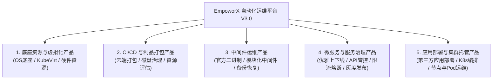

# EmpoworX 自动化运维平台 V3.0 - 产品矩阵与全局知识链图谱

> **创建日期**：2026-10-21  
> **文档定位**：全平台各产品线、业务功能、代码实现、页面路由、测试项及运维配置的全局核心索引枢纽。  
> **使用说明**：AI 助手与研发/测试/运维人员在接收到自然语言指令（如“服务优雅重启”、“限流配置发布”、“虚拟机创建”）时，优先通过本知识链图谱完成意图定位，并跳转到具体的场景链路和代码位置。

---

## 1. 业务产品矩阵架构划分

根据平台架构规划与实际工程职责，将 EmpoworX V3.0 拆分为 **5 大业务产品线**：

---

## 2. 5 大产品线全要素知识链大表

| 产品线 | 核心功能特性 | 需求编号 | 支撑后端模块/代码路径 | 前端页面/路由特征 | 关键端到端场景链 | 测试用例编号 | 运维与配置重点 |
| :--- | :--- | :--- | :--- | :--- | :--- | :--- | :--- |
| **P1. 底座资源与虚拟化产品** | 底座系统版本升级与国产OS适配 | BASE-01 | `src/syncplant-auto-deployment/template/` | `/system/os-upgrade` (底座适配) | 目标OS与CPU架构识别 -> 准入检测 -> 匹配新底座部署包 -> 执行冒烟验证 | `TC-SCN-001`, `TC-SCN-002` | Rocky 10 / Kylin V11 / TencentOS 4.4 高内核参数调优 |
| | KubeVirt 虚拟机全生命周期管控 | BASE-03 | `src/empoworx-kubea/controller/vm.go` `src/empoworx-kubea/service/vm.go` | `/virtualization/vms` (虚拟机管理) | 授权校验 -> 模板镜像选择 -> 资源配额与二次认证 -> KubeVirt VM 创建 -> 控制台登录 | `TC-SCN-004`, `TC-AUTH-001` | 资源配额限制、VNC/Web控制台连接、存储卷挂载 |
| **P2. CI/CD 与制品打包产品** | 微服务版本管理与发布追溯 | PIPE-01 | `src/empoworx-devops-cloud/empoworx-devops-cloud/controller/module.go` | `#/module/module` `#/module/detail` | 模糊检索模块 -> 查看发布版本与内容 -> 查看依赖树与制品 | `TC-CLOUD-003`, `TC-CLOUD-004` | 见 [云端控制台说明书](../01-requirements/2026-10-21-云端控制台产品说明书.md) |
| | 项目编排、构建打包与离线授权 | PIPE-01 | `src/empoworx-devops-cloud/empoworx-devops-cloud/controller/project.go` | `#/project/myproject` `#/project/detail` | 新建项目 -> 选择OS与CPU架构 -> 编排模块 -> 生成加密授权 | `TC-CLOUD-005`, `TC-CLOUD-006` | 管理员 ADMINCODE 特权控制、防误删保护 |
| | 实施客户端与物理设备安全绑定 | PIPE-02 | `src/empoworx-devops-cloud/empoworx-devops-cloud/controller/impl_client.go` | `#/impl_client/client` | 识别码上报 -> 工号白名单绑定 -> 离线同步许可 -> 一键安全解绑 | `TC-CLOUD-008`, `TC-CLOUD-009` | MAC 与全局设备识别码校验 |
| **P3. 中间件运维产品** | 官方中间件版本基线与生命周期 | MID-01 | `src/empoworx-devops-cloud/empoworx-devops-cloud/controller/middle.go` | `#/middlewareManage/middleware` | 中间件资产盘点 -> 官方版本升级发布 -> 运行状态跟踪 | `TC-CLOUD-010` | Nacos, XXL-Job, Redis, MySQL 等基线规范 |
| **P3. 中间件运维产品** | 官方二进制中间件替代 (去Bitnami) | BASE-02 | `src/syncplant-auto-deployment/services/middle.go` | `/middleware/binary-deploy` (中间件部署) | 官方源包校验 -> 自动化脚本渲染 -> 安装与端口绑定 -> 连通性探测 | `TC-SCN-003`, `TC-ERR-001` | Redis, MySQL, MongoDB, InfluxDB, RabbitMQ, MinIO 二进制脚本 |
| | 中间件模块化统一版本管控 | MID-01 | `src/empoworx-devops-cloud/empoworx-devops-cloud/controller/middle.go` | `/middleware/version-control` (版本控制) | 模块化清单维护 -> 版本基线定义 -> 一键升级/回滚 -> 依赖兼容性校验 | `TC-SCN-008` | 配置文件版本回溯、配置中心（Nacos）双向同步 |
| | 数据库自动化备份与恢复 (DbDump) | OPS-01 | `src/empoworx-kubea/controller/db_dump.go` `src/empoworx-kubea/service/db_dump.go` | `/middleware/db-backup` (数据备份) | 存储类指定 -> 备份任务创建 -> 周期调度执行 -> 导出与过期自动清理 | `TC-SCN-009` | NFS StorageClass 挂载、定时任务清理周期 |
| **P4. 微服务与服务治理产品** | 微服务优雅上下线与滚动升级 | GOV-01 | `src/empoworx-kubea/controller/graceful.go` `src/empoworx-kubea/service/graceful_startup_service.go` `src/syncplant-auto-deployment/services/kubea_graceful.go` | `/governance/graceful` (优雅发布) | 入口流量摘除 -> Nacos注销 -> XXL-Job暂停 -> MQ消费停止 -> 平滑停止 -> 启动反向预热 | `TC-SCN-010`, `TC-SCN-011`, `TC-SCN-012`, `TC-ERR-004` | 注册中心 Nacos 状态、XXL-Job 执行器心跳、MQ 消费缓冲时间 |
| | API 资产全生命周期管控与性能趋势 | GOV-02 | `src/empoworx-devops-cloud/empoworx-devops-cloud/controller/` | `/governance/api-control` (API管控) | 接口自动发现 -> 状态切换监控 -> InfluxDB指标采集 -> P95/P99性能看板展示 | `TC-SCN-013`, `TC-SCN-014`, `TC-SCN-015` | InfluxDB 指标写入延时、网关插件埋点开销 |
| | Sentinel 单服务限流与手动熔断降级 | GOV-03 | `src/empoworx-kubea/controller/graceful.go` `src/syncplant-auto-deployment/` | `/governance/sentinel-rules` (流量防护) | QPS限流配置 -> 推送 Nacos Sentinel Group -> 规则动态生效 -> 熔断上游异常调用 | `TC-SCN-016`, `TC-SCN-017`, `TC-ERR-005` | Nacos `SENTINEL_GROUP` 同步时延、流控降级日志 |
| | 微服务全链路灰度发布与流量切分 | GOV-04 | `src/empoworx-kubea/controller/graceful.go` | `/governance/gray-release` (灰度发布) | 灰度规则下发 (Header/Cookie/IP) -> 流量染色 -> 路由命中灰度实例 -> 渐进式放量 | `TC-SCN-018`, `TC-SCN-019` | 网关染色标透传、多版本服务共存隔离 |
| **P5. 应用部署与集群托管产品** | 第三方应用部署与容器编排 | APP-01 | `src/syncplant-auto-deployment/services/upgrade.go` `src/kubernetes-manifests/` | `/apps/marketplace` (应用中心) | 应用包上传与格式校验 -> Helm/YAML模板渲染 -> 命名空间部署 -> 状态探针检测 | `TC-SCN-020` | Helmfile 依赖处理、镜像仓库拉取凭证 |
| | K8s 节点、Pod与存储资产运维 | K8S-01 | `src/empoworx-kubea/controller/router.go` `src/empoworx-kubea/controller/deployment.go` | `/k8s/cluster-resources` (集群运维) | 污点与亲和性设置 -> 副本动态扩缩容 -> 滚动重启 -> Pod日志实时跟踪 | `TC-SCN-021` | Kube-apiserver 通信鉴权、节点污点容忍度 |
| | JVM OOM 自动化 Dump 与排障分析 | OPS-02 | `src/empoworx-kubea/controller/oom_dump.go` `src/empoworx-kubea/service/oom_dump.go` | `/ops/oom-dump` (故障转储) | Loki 监控到 OOM 事件 -> 自动触发 Dump -> 上传至 MinIO -> 企微报警推送 | `TC-SCN-022` | MinIO 预签名下载地址有效期、企业微信 Webhook 状态 |

---

## 3. 自然语言场景操作与知识链快速定位表

当用户提出以下典型需求时，AI 应立即顺着知识链提取上下文：

### 场景 1：“我要把一个出现内存泄漏的服务平滑重启，不要影响外部正在请求的用户”
1. **意图识别**：优雅重启（Graceful Restart）与流量平滑摘除。
2. **定位产品线**：P4. 微服务与服务治理产品。
3. **涉及页面**：`/governance/graceful` 或 `/k8s/deployment/detail`。
4. **触发后端 API**：
   - 检查状态：`GET /api/k8s/deployment/rollout-status`
   - 执行优雅重启：`POST /api/k8s/deployment/graceful-restart`
5. **后端代码位置**：
   - 入口路由：`src/empoworx-kubea/controller/router.go`
   - 控制器：`src/empoworx-kubea/controller/graceful.go` -> `Graceful.RestartDeployment`
   - 核心服务：`src/empoworx-kubea/service/graceful_startup_service.go`
6. **场景链路**：
   - ① 检查 Deployment 当前 Ready 副本数；
   - ② 逐个 Pod 摘除（Nacos 标记下线 -> 暂停 XXL-Job -> 阻塞等待在途流量完成）；
   - ③ 调用 K8s API 触发新 Pod 启动；
   - ④ 新 Pod Readiness 探针通过后反向预热并注册回 Nacos；
   - ⑤ 轮询 Rollout 状态直至全部副本 Ready。
7. **对应测试项**：`TC-SCN-010`, `TC-SCN-012`, `TC-ERR-004`。

---

### 场景 2：“订单接口突发流量过大，帮我配个限流规则，只允许每秒 1000 QPS，超过快速失败”
1. **意图识别**：API 管控与单服务 QPS 限流配置发布。
2. **定位产品线**：P4. 微服务与服务治理产品。
3. **涉及页面**：`/governance/api-control` -> 选定接口 -> 弹窗“配置限流”。
4. **触发后端 API**：
   - 保存流控规则：`POST /api/flowRule/save`
   - 推送配置至 Nacos：`POST /api/flowRule/publish`
5. **后端代码位置**：
   - `src/syncplant-auto-deployment/services/`
   - 注册中心交互：`src/empoworx-devops-cloud/empoworx-devops-cloud/nacos/`
6. **场景链路**：
   - ① 前端自动带出 API 路径与服务名；
   - ② 填入 QPS 阈值 1000、统计窗口 1s、流控效果“快速失败”；
   - ③ 后端校验合法性后写入平台持久化存储；
   - ④ 异步推送到 Nacos `SENTINEL_GROUP` 下的对应 DataId；
   - ⑤ 网关及应用端 Sentinel 动态监听刷新；
   - ⑥ 监控看板观察拒绝 QPS 是否正确产生。
7. **对应测试项**：`TC-SCN-016`, `TC-ERR-005`, `TC-ERR-006`。

---

### 场景 3：“服务 Pod 频繁崩溃，我们需要在 OOM 发生的瞬间保留現場并抓出堆内存”
1. **意图识别**：JVM OOM 自动抓取与转储分析。
2. **定位产品线**：P5. 应用部署与集群托管产品 (监控与排障)。
3. **涉及页面**：`/ops/oom-dump`。
4. **触发后端 API**：
   - 开启自动抓取：`POST /api/k8s/dump/autodump/start`
   - 手动触发转储：`POST /api/k8s/dump/trigger`
   - 状态查询与下载：`GET /api/k8s/dump/url`
5. **后端代码位置**：
   - 控制器：`src/empoworx-kubea/controller/oom_dump.go`
   - 业务逻辑：`src/empoworx-kubea/service/oom_dump.go`
6. **场景链路**：
   - ① 守护服务监听 Loki 的 OOMKilled 日志流；
   - ② 捕获告警后向目标容器注入 `jcmd/jmap` 转储命令；
   - ③ 临时压缩 dump 文件并通过流式传输推送到 MinIO 存储桶；
   - ④ 触发企微机器人 Webhook 告警，带上 1 小时有效的预签名下载链接；
   - ⑤ 清理容器内临时文件，防止存储卷打满。
7. **对应测试项**：`TC-SCN-022`。
