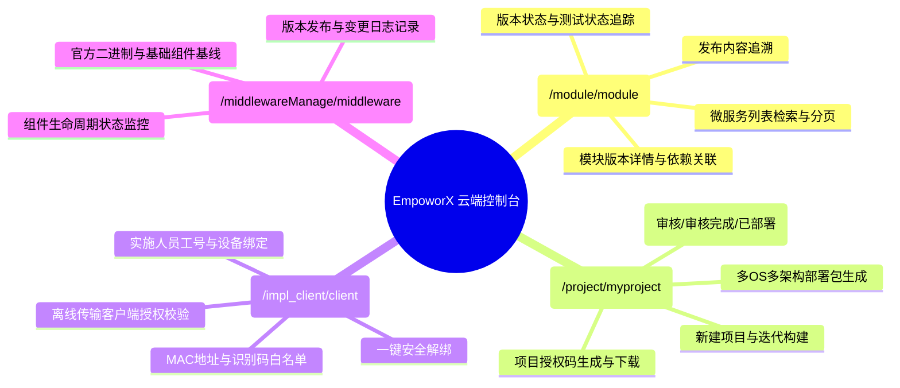

# 云端控制台产品说明书 (EmpoworX DevOps Cloud)

> **文档版本**：V1.0  
> **编写日期**：2026-10-21  
> **运行环境**：测试环境（`http://10.88.12.80:18880/devops/`）  
> **登录身份**：王壮 (5807，超级管理员)  
> **产品定位**：企业级微服务登记、版本生命周期追溯、制品打包分发、跨环境传输工具授权与官方中间件版本基线管理中心。

---

## 1. 产品核心业务定位

云端控制台（EmpoworX DevOps Cloud）是连接业务微服务研发、构建打包、现场实施交付与基线中间件的核心中枢。它解决了如下核心问题：
1. **微服务资产与版本统一纳管**：纳管 130+ 个业务模块（如 PDMTEST、METRIC、SCM、HSE、TPM、CSM、EALM 等），精确记录各微服务发布版本号、构建时间、测试验证状态与变更内容。
2. **多环境项目发布包编排**：支持按项目编排制品（如国产高内核 Rocky10.1、KylinV11、TencentOS4.4 的 x86/ARM 二进制包及微服务增量包），支持生成一键授权。
3. **安全受控的传输工具绑定**：针对现场实施人员或开发机（PC5771、PC4557 等），基于工号、MAC 地址和全局唯一设备识别码进行物理硬件绑定与授权解绑，防止安装包非授权扩散。
4. **官方中间件版本基线库**：统一收敛 Nacos、XXL-Job、Seata、Redis、MySQL、MinIO、MongoDB、RabbitMQ、InfluxDB 等官方镜像与二进制版本的生命周期与升级记录。

---

## 2. 核心功能模块清单

---

## 3. 环境拓扑与角色配置

- **生产环境**：`http://devops.empoworx.net:13032/devops/`
- **测试环境**：`http://10.88.12.80:18880/devops/`
- **开发环境**：`http://10.44.3.61:18880/devops/`
- **认证方式**：集成 Sciyon ERP 统一单点认证（工号 + ERP 密码），设有防暴力破解锁定机制。
- **特权账号 (ADMINCODE)**：`5771, 2049, 4557, 5807`（拥有项目生成授权、全局中间件发布、设备解绑的超级管理员权限）。
