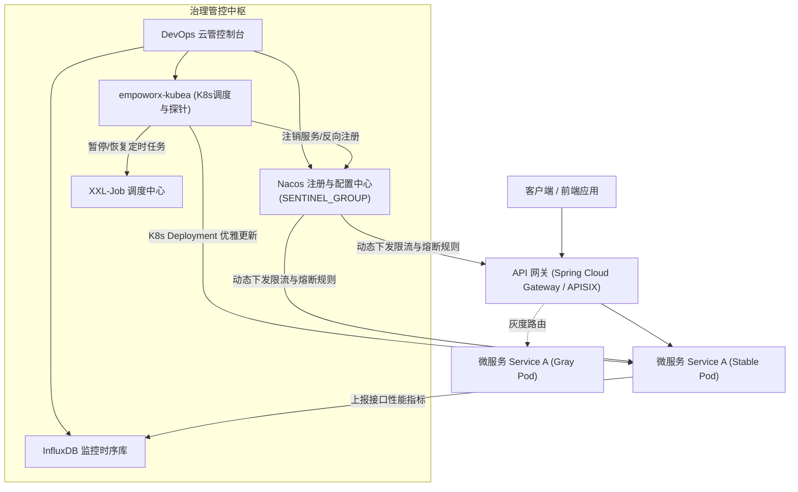

# 微服务与服务治理产品说明书 (Microservice & Service Governance)

> **文档版本**：V1.0  
> **编写日期**：2026-10-21  
> **所属平台**：EmpoworX 自动化运维平台 V3.0  
> **产品责任人**：王子榕  
> **产品定位**：解决工业互联网与企业级微服务集群在发布变更、流量突发、故障隔离与运行观测中的高可用与稳定性挑战。

---

## 1. 产品背景与业务价值

在大型工业微服务系统中，成百上千个微服务副本高频次迭代，频繁面临如下痛点：
1. **发布即抖动**：直接强杀容器（SIGKILL）会导致在途 HTTP/RPC 请求大量超时报错；新容器启动瞬间大量流量涌入造成 CPU 瞬间被打死（冷启动）。
2. **API 盲区**：缺乏全局 API 资产盘点，无法量化各微服务接口的真实调用 QPS、P95/P99 响应耗时与错误率。
3. **雪崩效应**：某一个底层依赖（如权限、库存服务）异常时，引发上游服务级联阻塞，导致全站崩溃。
4. **全量发布风险高**：新版本未经生产流量小范围验证，一旦存在隐蔽 Bug 将影响全部租户与用户。

**微服务与服务治理产品** 提供一套与基础设施透明集成的治理中枢，覆盖从“发布前验证 -> 渐进式发布 -> 运行期流量防护 -> 性能度量”的全生命周期管控。

---

## 2. 核心功能特性清单

| 功能模块 | 功能名称 | 业务价值 | 核心指标 / SLA |
| :--- | :--- | :--- | :--- |
| **优雅上下线** | 优雅停机 (Graceful Shutdown) | 确保在途请求处理完毕，外部流量提前平滑摘除 | 停机过程中 0 笔业务 502/504 错误 |
| | 预热启动 (Warm-up) | 解决 JVM/JIT 编译期及连接池初始化的冷启动毛刺 | 启动流量按曲线缓慢递增，CPU 尖刺降低 60% |
| | 滚动优雅重启/升级 | 在无损业务连续性的前提下，逐副本替换 Deployment | 发布期间集群对外服务可用性 100% |
| **API 管控中心** | 资产自动发现与分类 | 统一盘点微服务接口，按模块功能树沉淀 API 字典 | 接口发现覆盖率 100% |
| | 性能趋势与多维指标 | 实时呈现 QPS、平均耗时、P90/P95/P99、状态码分布 | 监控指标延迟 < 5 秒 |
| | 一键启用/禁用监控 | 按需开启高精度指标埋点，降低系统开销 | 毫秒级配置下发生效 |
| **Sentinel 流量防护**| 单服务 QPS 限流 | 防止突发洪水流量击垮后端服务，保护核心资源 | 超过阈值毫秒级快速失败，不堆积请求 |
| | 动态熔断与故障隔离 | 发生异常或依赖故障时，自动或手动熔断上游异常调用 | 隔离故障源，避免微服务级联雪崩 |
| | 规则配置双向同步 | 平台控制台与 Nacos `SENTINEL_GROUP` 实时双向同步 | 规则下发生效时延 < 1 秒 |
| **全链路灰度发布** | 流量染色与标签路由 | 基于 Header、Cookie、客户端 IP 进行精准流量识别 | 染色流量 100% 准确路由至灰度容器 |
| | 渐进式放量与一键回退 | 支持按比例/租户逐步放大灰度范围，异常时一键回退 | 回退生效时间 < 3 秒 |

---

## 3. 系统架构与关键技术机制

---

## 4. 关键角色与权限规范

1. **平台超级管理员**：拥有所有服务、全部命名空间、全局限流熔断策略的完全控制权。
2. **微服务开发人员**：维护自身负责模块的接口元数据、配置限流与告警阈值、发起灰度发布申请。
3. **运维与发布工程师**：执行优雅重启、Deployment 滚动升级、应急手动熔断、紧急流量切回。
4. **测试工程师**：设计端到端验证用例，在预发与灰度环境中执行自动化与手工业务场景验证。
