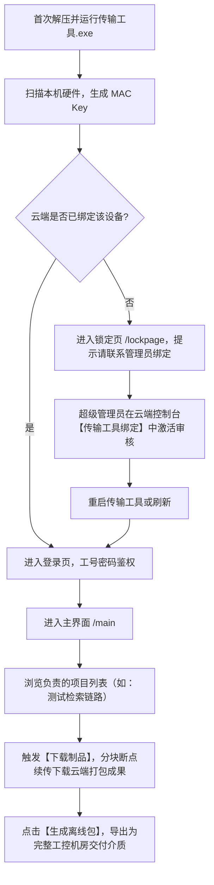

# 自动化运维传输工具（Implement Client）产品说明书

## 1. 产品定位与核心价值

“自动化运维传输工具”（简称“传输工具”）是科远智慧自动化运维平台面向**现场实施工程师与工程交付人员**设计的专用 Windows 桌面客户端程序。

### 1.1 核心痛点
- **现场与工控隔离**：电厂、化工厂等工业控制机房通常属于严格物理隔离的工业局域网（无互联网连接），无法直接访问云端 DevOps 平台拉取镜像与配置；
- **制品体积庞大**：微服务底座、中间件二进制（Rocky10.1 等）、业务服务镜像动辄数 GB 到数十 GB，人工拷贝易遗漏、校验繁琐；
- **环境安全合规与设备准入**：严禁未经授权的私人电脑随意下载电厂客户的核心项目工程与代码包，必须实行“强设备身份认证与授权绑定”。

### 1.2 核心能力
1. **硬件级设备准入（MAC / Key 绑定）**：客户端启动时自动采集本地硬件特征并在云端控制台审核激活，未绑定状态自动进入锁定页（`/lockpage`）；
2. **多环境隔离（生产 / 测试 / 开发）**：独立适配三大环境配置，通过本地缓存隔离（`C:\Users\<user>\.sciyon`）防止环境数据串台；
3. **云端制品按需拉取与断点续传**：基于 HTTP/HTTPS 大文件分块传输，下载云端项目打包完成的中间件安装包与微服务镜像；
4. **一键制作与导出离线安装介质**：将项目运行所需的操作系统底座、中间件离线包、部署执行脚本整理封装为可直接携带至机房安装的标准介质包；
5. **现场运维数据离线采集与回传**：在现场执行部署、巡检或故障排查后，离线记录日志、检测结果与 License 授权信息，并在重新连接网络时一键同步至云端。

---

## 2. 三大部署环境与传输工具对应机制

| 环境类型 | 云端控制台地址 | 传输工具内置服务器 IP | 本地配置文件路径 | 说明 |
| :--- | :--- | :--- | :--- | :--- |
| **生产环境** | `http://devops.empoworx.net:13032/devops/` | `devops.empoworx.net:13032` | 内嵌 `prod/base.toml` | 生产客户实际交付使用 |
| **测试环境** | `http://10.88.12.80:18880/devops/` | `10.88.12.80:18880` | 内嵌 `dev/base.toml` | 内部功能测试与场景验证（当前环境） |
| **开发环境** | `http://10.44.3.61:18880/devops/` | `10.44.3.61:18880` | 内嵌 `dev/base.toml` | 研发联调环境 |

> [!IMPORTANT]
> **多环境切换黄金规则**：
> 传输工具启动后会在用户的系统目录 `C:\Users\<username>\.sciyon` 下生成设备硬件绑定 Key、本地 SQLite 数据库、项目离线缓存与用户凭证。**在切换不同环境的传输工具前，必须清理或删除该目录**；若在同一环境下连续使用，则无需清理。

---

## 3. 本地架构与目录设计

传输工具解压至本地目录后结构如下：
```text
D:\wsl\workspace\autoDevV3.0\tools\传输工具-test-v3.0.0.3\
├── 自动化运维传输工具.exe       # 核心服务端主进程（Go + Gin 架构，监听本地 :8880）
├── run.bat                     # 便捷启动脚本（自动 cd 至当前目录并后台拉起）
├── conf/
│   ├── dev/base.toml           # 测试/开发环境网络端口与云端 IP 配置
│   └── prod/base.toml          # 生产环境网络端口与云端 IP 配置
├── data/
│   ├── X86/deploy.tar          # x86 架构部署基础引导包
│   └── arm/deploy.tar          # ARM 架构部署基础引导包
└── dist/                       # 内置本地 Web 前端资源（Vue 2 + Element-UI）
    ├── index.html
    ├── js/
    └── cdn/
```

用户工作区缓存目录（`C:\Users\<username>\.sciyon\`）：
```text
C:\Users\<username>\.sciyon\
├── mac/key                     # 当前设备 MAC 散列唯一标识
├── user/                       # 离线 License 凭证与用户鉴权缓存
└── data/                       # 本地离线数据库与各项目缓存数据
    ├── <project_id>/           # 项目专属离线制品与清单
    ├── detectionList/          # 现场检测结果暂存
    └── inspectionRecordList/   # 现场巡检记录暂存
```

---

## 4. 传输工具端到端核心业务流



---

## 5. 虚拟机依赖与 AI 装机（MCP aizhuangji）人机协同机制

在实际现场或测试环境执行初次部署时，必须具备运行目标系统的虚拟机；若机器未就绪，需与 MCP 装机链路协同：

### 5.1 装机前置依赖关系
- 传输工具的 `[安装控制台]`（`/install_deployment`）依赖目标机 `SSH 22` 端口与当前网络完全连通；
- 若目标机未开机或尚未创建，系统将自动触发保护性拦截（报 `无法访问指定服务器`）。

### 5.2 MCP aizhuangji 协同与人工审核门禁
1. **Excel 自动解析与计划生成**：AI 读取项目导出的服务器清单 Excel（如 16C/32G/200G、Rocky 10.1、`10.44.3.194`），调用 MCP `aizhuangji` 工具生成批量装机方案；
2. **IP 冲突防覆盖检查（必须 Ping 不通）**：
   - 装机前必须执行目标 IP 的 Ping 存活探测；
   - **只有当目标 IP 彻底 Ping 不通**（无存活主机占用该 IP，避免误覆盖现场业务机）时，才满足装机前置条件；
   - 向用户呈报时必须显式标注其 Ping 不通状态并附带真实测试命令证据；
3. **人工审核门禁（强制红线）**：装机操作**绝对禁止全自动盲目执行**。AI 必须将装机计划表（宿主机、规格、IP、操作系统、存储分配、IP 探测标注）清晰展示给用户，由用户进行人工审核；
4. **确认后触发自动化装机**：在“Ping 不通”前提满足且收到用户明确确认后，AI 方可调用 MCP 的作业提交接口，通过 PXE 自动化完成 Rocky 10.1 系统部署、LVM 磁盘划分与网络初始化；
5. **自动化接力部署**：装机完成且目标机开机验证正常后，AI 自动接力在传输工具中执行后续动作：
   - 自动点击 `[安装控制台]`；
   - 自动点击 `[一键初次部署]`；
   - 自动接入并监控部署日志流，直至项目全量部署完成并归档。

