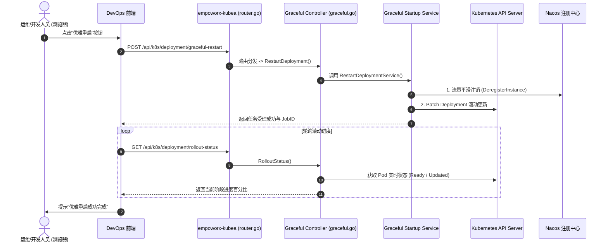

# 微服务与服务治理 - 端到端场景链与只读代码映射

> **文档版本**：V1.0  
> **编写日期**：2026-10-21  
> **使用定位**：为 AI 在执行代码阅读、问题排查、跨模块场景理解时，提供精确的代码文件路径、函数入口及调用时序映射（严格遵循代码只读规则）。

---

## 1. 核心场景操作链与代码映射总览



---

## 2. 核心场景逐一映射详情

### 场景一：微服务优雅下线与优雅上线 (Graceful Offline / Online)

#### 1. 场景业务链
1. 运维在前端发出“下线目标 Pod”请求；
2. 服务向注册中心发送服务临时下线状态通知，防止新流量打入；
3. 发送停止信号给内部调度中心（XXL-Job）和消息队列 Consumer，不再拉取新任务；
4. 预留 15~30 秒排空正在处理的在途业务请求；
5. 执行最终 Pod 容器 Terminate。

#### 2. 代码实现映射表 (只读)
- **API 路由定义**：
  - 文件：[`src/empoworx-kubea/controller/router.go`](file:///mnt/d/wsl/workspace/autoDevV3.0/src/empoworx-kubea/controller/router.go#L60-L65)
  - 路由声明：
    ```go
    POST("/api/k8s/graceful/online", Graceful.Online)
    POST("/api/k8s/graceful/offline", Graceful.Offline)
    POST("/api/k8s/deployment/graceful-restart", Graceful.RestartDeployment)
    POST("/api/k8s/deployment/graceful-upgrade", Graceful.UpgradeDeployment)
    GET("/api/k8s/deployment/rollout-status", Graceful.RolloutStatus)
    ```
- **控制器层 (Controller)**：
  - 文件：[`src/empoworx-kubea/controller/graceful.go`](file:///mnt/d/wsl/workspace/autoDevV3.0/src/empoworx-kubea/controller/graceful.go)
  - 方法：
    - `Graceful.Offline(ctx *gin.Context)`：参数校验（Namespace, PodName, ClusterName），触发下线工作流。
    - `Graceful.Online(ctx *gin.Context)`：触发反向注册与预热上线。
- **业务服务层 (Service)**：
  - 文件：[`src/empoworx-kubea/service/graceful_startup_service.go`](file:///mnt/d/wsl/workspace/autoDevV3.0/src/empoworx-kubea/service/graceful_startup_service.go)
  - 单测文件：[`src/empoworx-kubea/service/graceful_startup_service_test.go`](file:///mnt/d/wsl/workspace/autoDevV3.0/src/empoworx-kubea/service/graceful_startup_service_test.go)
- **调度协调服务 (Syncplant Auto Deployment)**：
  - 文件：[`src/syncplant-auto-deployment/services/kubea_graceful.go`](file:///mnt/d/wsl/workspace/autoDevV3.0/src/syncplant-auto-deployment/services/kubea_graceful.go)
  - 作用：在大规模流水线升级时，统一封装对 `kubea` 优雅接口的远程 HTTP/RPC 协同调度。

---

### 场景二：API 资产发现、状态控制与 InfluxDB 指标收集

#### 1. 场景业务链
1. 网关与微服务框架启动时，自动上报 Controller 层所有路由路径、请求方法和注释说明；
2. 开发者在“API 管控”界面查询接口列表，开启/关闭单接口细粒度监控；
3. 网关拦截器实时将请求耗时与状态码打点推入 InfluxDB；
4. 运维在“API 性能趋势”弹窗中按近 1 小时 / 近 1 天查看 QPS、P95、P99 及错误率。

#### 2. 代码实现映射表 (只读)
- **后端控制器 (Controller)**：
  - 路由入口：`src/empoworx-devops-cloud/empoworx-devops-cloud/controller/`
  - 接口清单：
    - `GET /apiControl/page`：分页查询接口资产列表，带出实时/近 1 小时 QPS 与耗时指标。
    - `POST /apiControl/monitorStatus`：切换接口监控开启状态，落库并通知监控采集端。
    - `GET /apiControl/trend`：根据 `apiRoute` 与 `timeType`（1h / 1d）查询 InfluxDB 时序聚合数据。
- **时序与数据接入层**：
  - 数据库适配：InfluxDB 客户端读取与时序 SQL 构建。
  - 兜底处理：当 InfluxDB 暂时离线或指标缺失时，接口列表优雅降级展示基础资产信息，并在响应中返回“指标暂时不可用”而非直接报 500。

---

### 场景三：单服务 QPS 限流与 Nacos SENTINEL_GROUP 规则发布

#### 1. 场景业务链
1. 开发者在 API 管控列表选中核心写接口（如订单创建接口 `/api/order/create`）；
2. 填写限流规则：单服务 QPS = 1000，统计时间窗口 = 1s，流控模式 = 快速失败；
3. 后台服务校验参数（禁止负数、仅支持 QPS 模式、暂禁用线程数模式）；
4. 数据落入持久化配置表，状态标记为 `UNPUBLISHED`；
5. 调用 Nacos Open API 将 Sentinel 规则推送到 `SENTINEL_GROUP`，对应 DataId 为 `{serviceName}-flow-rules`；
6. 收到 Nacos 成功响应后，将本地状态更新为 `PUBLISHED` 并记录操作审计。

#### 2. 代码实现映射表 (只读)
- **规则定义与控制器**：
  - 文件：[`src/empoworx-kubea/controller/graceful.go`](file:///mnt/d/wsl/workspace/autoDevV3.0/src/empoworx-kubea/controller/graceful.go)
  - 规则数据结构（DTO）：定义 FlowRule，包含 `Resource`, `Count`, `Grade` (0:线程数, 1:QPS), `LimitApp`, `Strategy` 等。
- **Nacos 同步客户端**：
  - 文件路径：`src/empoworx-devops-cloud/empoworx-devops-cloud/nacos/`
  - 异常保护：若 Nacos 发布接口超时或失败，事务保护回滚，保留数据库草稿并向前端准确返回失败阶段及 TraceId。

---

### 场景四：基于上游调用源的手动熔断降级

#### 1. 场景业务链
1. 当某个上游服务（如 `syncplant-business-pdm`）出现死循环刷接口异常时；
2. 运维人员在当前服务详情的“熔断配置”中，新增指定上游服务的调用隔离规则；
3. 系统将针对该上游的调用阈值设置为 `count = 0`，推送到 Sentinel 网关规则；
4. 网关直接阻断来自该异常上游的请求，其他正常上游不受影响；
5. 故障排查完毕后，一键解除熔断，恢复调用。

#### 2. 代码实现映射表 (只读)
- **业务实现**：
  - 熔断策略通过 Sentinel `DegradeRule` 或 `FlowRule (limitApp)` 实现上游调用方粒度的动态拦截。
  - 审计机制：记录操作人、熔断原因、生效时间，并在监控看板中打上“熔断事件标记”。
