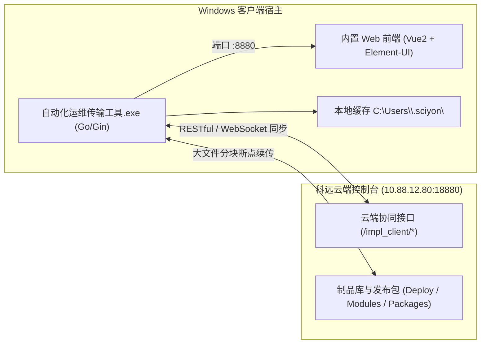

# 自动化运维传输工具（Implement Client）本地架构与数据同步知识库

## 1. 软件架构概览

自动化运维传输工具采用 **轻量级本地 Go 服务（后端） + 嵌入式 Web 前端（Vue 2 + Element-UI）** 的 C/S 混合架构。

---

## 2. 本地缓存目录结构（`.sciyon`）深度解析

当传输工具在某环境（如测试环境）首次拉起并授权时，会在 `C:\Users\<Username>\.sciyon` 下初始化如下目录树：

| 相对路径 | 文件/目录类型 | 作用与存储内容 |
| :--- | :--- | :--- |
| `mac/key` | 文本文件 | 本机硬件唯一散列识别码（UUID 格式），用于向云端申请设备注册 |
| `user/<hash>.lic` | 加密二进制 | 云端签发的设备授权 License 文件，凭此证明该物理机属于公司合规准入设备 |
| `data/data/project` | SQLite / 二进制 | 本地缓存的用户可见项目元数据列表 |
| `data/<project_id>/` | 目录 | 项目专属工作区（例如 `523` 对应“测试检索链路”） |
| `data/<project_id>/data/` | 目录 | 该项目的中间件清单、模块版本要求与断点续传队列索引 |

> [!WARNING]
> **多环境串台根因**：
> `user/*.lic` 和 `mac/key` 强绑定于特定云端控制台（如测试环境 `10.88.12.80:18880`）。当切换至生产环境（`devops.empoworx.net:13032`）或开发环境时，若未清空 `.sciyon`，程序会读取旧环境的授权与项目元数据，导致设备验证失败或项目列表不一致。

---

## 3. 设备授权与激活交互链（`toCloud`）

1. **未授权拦截**：
   若本地无有效 `.lic` 或云端未审批，路由重定向至 `/lockpage`，提示“请联系管理员授权”。
2. **一键授权流转**：
   用户点击 `[前往云端授权机器]`，前端调用本地 `toCloud()` 方法：
   - 提取当前设备的机器名称与 MAC 标识；
   - 携带参数重定向至云端：`http://<server_ip>:<port>/devops/#/login?data=<encoded_params>`；
3. **云端审核准入**：
   管理员或已登录人员在云端确认后，云端接口 `/impl_client/register_my_device` 将设备持久化至 `tbl_client_device`，并签发 License 回调本地客户端；
4. **状态解锁与进入主屏**：
   客户端接收授权后，解除锁定，流转至主视图 `/index/#/module/blank`，显示“科远云已连接”。

---

## 4. 项目同步与初次部署视图

在传输工具主界面中，已登录用户（如超级管理员王壮）负责的项目自动呈现于侧边栏：
- **未部署**：包含刚刚在云端完成打包的项目（如 `测试检索链路` ID: `523`）；
- **已部署**：现场已安装并回传过部署状态的项目。

进入项目主视图后，核心运维功能包括：
1. **传输工具下载与更新**：检测本地二进制与云端最新版的版本一致性；
2. **控制台安装状态**：现场工控机是否已部署统一运维控制台；
3. **部署日志监控**：提供 `刷新日志` 与 `下载日志`，可导出脱机部署审计日志。
