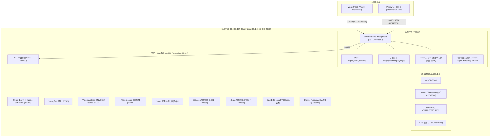

# 运维控制台（Deployment Console）与宿主环境全景架构探索报告

## 1. 架构总览与拓扑全景

运维控制台（Syncplant Auto Deployment Console）是科远工业互联网平台在私有化或边缘现场的核心运维底座，集成了**集群初始化、应用微服务生命周期编排、中间件治理、可观测监控告警、数据同步与环境灾备**等多维核心能力。



---

## 2. 宿主服务器基础规格与环境资产

- **主机名称**：`master1`
- **内网 IP**：`10.44.3.194`
- **操作系统**：Rocky Linux 10.1 (Red Quartz)，平台 ID：`platform:el10`
- **系统内核**：`6.12.0-124.8.1.el10_1.x86_64`
- **计算资源**：
  - CPU：16 核（Intel Xeon CPU E5-2686 v4 @ 2.30GHz）
  - 内存：31GiB（已用 14GiB，空闲 1.1GiB，缓存 15GiB，可用 16GiB）
- **磁盘分区与存储**：
  - 系统盘：`/dev/sda`（200GB），LVM 卷 `/dev/mapper/rl-root`（199GB）
  - 占用率：已使用 61GB，空闲 139GB（使用率 31%）
  - 持久化集中挂载根路径：`/data/`

---

## 3. 运维控制台核心组件剖析

### 3.1 进程与服务定义
- **主进程**：`/deployment/deploy/syncplant-auto-deployment`（Go 编译二进制，88MB）
- **启动命令**：`./syncplant-auto-deployment -config=./conf/dev/`
- **工作目录**：`/deployment/deploy`
- **服务守护**：`/etc/systemd/system/syncplant-auto-deployment-initial.service`（自启与保活，重启间隔 3 秒）

### 3.2 默认认证凭据与用户体系
配置文件位于 `/deployment/deploy/conf/dev/base.toml` 和 `custom.toml`：

| 角色/服务 | 用户名 | 默认密码 | 说明 |
| :--- | :--- | :--- | :--- |
| **控制台超级管理员** | `superAdmin` | `Syncp1@nt2024*-+123!` | 拥有最高系统配置与安全权限 |
| **控制台运维管理员** | `admin` | `Syncp1@nt2024*-+` | 负责服务部署、中间件维护、巡检与限流 |
| **只读观察员** | `guest` | `Syncp1@nt2024*-+` | 仅支持查看仪表盘与状态 |
| **Nacos 配置中心** | `nacos` | `Nacossciyon2024*-+` | 微服务配置与注册凭据 |
| **Harbor 镜像仓** | `admin` | `Harbor12345` | 私有容器镜像推送与拉取凭据 |
| **中间件通信 Token** | `middleAgent` | `a6d0f424206d233...` | 内部 Agent 心跳与指令校验签名 |

### 3.3 数据库模型 (`deployment_data.db`)
控制台使用 SQLite3 进行轻量级状态持久化与审计记录：

| 数据表名 | 用途描述 | 当前记录数/状态 |
| :--- | :--- | :--- |
| `upgrade_notify_record` | 版本升级与通知流水 | 记录项目 523 已升级至 `3.0.0.3` |
| `environment_import_guard` | 环境导入防误触保护门禁 | `version=v1`（初次部署成功后落锁） |
| `inspection_strategy` | 系统健康巡检策略字典 | P1 人工干预、P2 磁盘 IO Wait、P4 K8s 集群巡检 |
| `data_sync_config` / `masking_sql` | 生产到测试数据同步与 SQL 脱敏 | 动态配置脱敏规则与同步流水 |
| `scheduled_backup_config` | 宿主与集群定时环境备份任务 | 自动快照与导出配置 |
| `breaker_control` | 微服务调用链路熔断降级策略表 | 支持根据 API 错误率动态熔断 |

---

## 4. 全局端口与服务暴露全景映射

| 服务名称 | 监听 IP / 端口 | 部署方式 | 对外访问说明 |
| :--- | :--- | :--- | :--- |
| **运维控制台 Web UI** | `0.0.0.0:18880` | 原生 Go 进程 | 主入口：`http://10.44.3.194:18880/index/` |
| **文件流传输服务** | `0.0.0.0:18881` | 原生 Go 进程 | 接收传输工具介质推送与离线日志拉取 |
| **Grafana 监控大屏** | `NodePort :30090` | K8s Pod (vmks) | 监控仪表盘：`http://10.44.3.194:30090` |
| **XXL-Job 任务调度** | `NodePort :30088` | K8s Pod (middle) | 调度中心：`http://10.44.3.194:30088` |
| **Seata 分布式事务** | `NodePort :30893` | K8s Pod (middle) | 事务控制台：`http://10.44.3.194:30893` |
| **Hubble 网络拓扑 UI** | `NodePort :31235` | K8s Pod (kube-system) | eBPF 网络流向视图：`http://10.44.3.194:31235` |
| **K8s 控制面 API (kubea)**| `NodePort :30099` | K8s Pod (backend) | 平台微服务调度与 YAML 控制器接口 |
| **Nginx 业务代理** | `NodePort :30010` | K8s Pod (frontend) | 平台微服务业务反向代理主入口 |
| **Docker 私有镜像仓** | `NodePort :30500` | K8s Pod (registry) | 镜像推送仓：`10.44.3.194:30500` |
| **VictoriaLogs 写入端** | `NodePort :30481` | K8s Pod (vmks) | 高性能日志收集落盘端口 |
| **Redis 6节点高可用集群**| `0.0.0.0:6379~6384` | 宿主机进程集群 | 原生 Redis 集群（总线端口 16379~16384） |
| **MySQL 关系数据库** | `0.0.0.0:3306` | 宿主机进程 | 原生 mysqld |
| **RabbitMQ 消息中间件**| `0.0.0.0:5672/15672` | 宿主机进程 | 原生 AMQP 与 Web 管理端 |
| **NFS 共享存储服务** | `0.0.0.0:111/2049` | 宿主机内核模块 | 为 K8s 提供动态挂载卷支持 |

---

## 5. 存储架构与数据持久化目录树

```
/data/
├── backup/                 # 控制台与环境离线灾备存储包
├── containerd/             # 容器镜像层、快照与运行时数据
├── influxdb/               # InfluxDB 时序库数据文件
├── kubelet/                # K8s Pod 挂载卷与 Subpath 隔离目录
├── middle/                 # 中间件持久化配置与运行日志
├── middle_agent/           # 中间件管控 Agent 二进制、配置与 Watchdog
├── minio/                  # MinIO 对象存储 Bucket 数据
├── mongodb/                # MongoDB 文档数据库数据
├── mysql/                  # MySQL 数据目录 (ibdata, binlog 等)
├── openebs/                # OpenEBS LocalPV 默认存储卷池
├── rabbitmq/               # RabbitMQ 消息与元数据
├── redis-cluster/          # Redis 6 节点 nodes.conf 与 dump.rdb
├── registry/               # Docker 私有镜像仓 Blobs 存储
└── repos/                  # 本地离线 RPM YUM 软件源
```

---

## 6. 运维与生命周期管理常用操作规范

### 6.1 控制台主程序启停
- 重启控制台服务：
  ```bash
  systemctl restart syncplant-auto-deployment-initial.service
  ```
- 查看控制台实时日志：
  ```bash
  tail -f /deployment/deploy/logs/syncplant-auto-deployment.inf.log
  ```

### 6.2 中间件 Agent 监控与保活
- 检查 Agent 状态：
  ```bash
  systemctl status middle-agent-watchdog.service
  ```
- 查看看门狗日志：
  ```bash
  tail -f /data/watchdog.log
  ```

### 6.3 云原生集群状态排查
- 查看所有节点与 Pod：
  ```bash
  kubectl get nodes -o wide
  kubectl get pods -A -o wide
  ```
- 查看 Helm 部署状态：
  ```bash
  helm list -A
  ```
