# 运维控制台（Deployment Console）前台功能与全模块使用手册

## 1. 登录与控制台主界面入口

- **前台 Web 访问地址**：`http://10.44.3.194:18880/index/#/login`
- **默认管理员凭据**：
  - 用户名：`admin`
  - 密　码：`Syncp1@nt2024*-+`
- **超级管理员凭据**：
  - 用户名：`superAdmin`
  - 密　码：`Syncp1@nt2024*-+123!`
- **会话机制**：登录成功后下发 `mysession` Cookie，有效期 30 天，支持多标签页保活。

---

## 2. 前台核心功能架构全景

```mermaid
graph TD
    ConsoleRoot["运维控制台 Web UI (:18880)"]

    ConsoleRoot --> M1["1. 微服务部署与治理 (/serve)"]
    ConsoleRoot --> M2["2. 中间件管控平台 (/middlewareManage)"]
    ConsoleRoot --> M3["3. 云原生与Helm应用 (/thirdPartyDeploy)"]
    ConsoleRoot --> M4["4. 监控告警大屏 (/warn)"]
    ConsoleRoot --> M5["5. 集群巡检管理 (/inspectionManagement)"]
    ConsoleRoot --> M6["6. 流量流控与熔断 (/apiControl)"]
    ConsoleRoot --> M7["7. 数据同步与环境灾备 (/environmentSync)"]
    ConsoleRoot --> M8["8. 平台配置与工具箱 (/config)"]
    ConsoleRoot --> M9["9. 系统操作审计日志 (/operate)"]

    M1 --> M1_1["服务列表 / 状态监控"]
    M1 --> M1_2["滚动发布 / 进度查询"]
    M1 --> M1_3["平滑上下线 / 优雅重启"]
    M1 --> M1_4["Flyway 数据库迁移日志"]
    M1 --> M1_5["节点亲和性 (NodeAffinity)"]

    M2 --> M2_1["9大中间件矩阵 (Redis/MySQL/Nacos等)"]
    M2 --> M2_2["一键重启 / 在线 / 离线"]
    M2 --> M2_3["连接信息与密码一键修改"]

    M3 --> M3_1["Helm 应用市场 / 离线包导入"]
    M3 --> M3_2["Values.yaml 在线编辑与渲染"]
    M3 --> M3_3["独立单机/哨兵 Redis 扩展"]

    M4 --> M4_1["节点 CPU/内存/IO 水位 Top5"]
    M4 --> M4_2["K8s 节点拓扑与状态"]
    M4 --> M4_3["跳转 Grafana 监控大屏 (:30090)"]

    M5 --> M5_1["P1 人工干预门禁"]
    M5 --> M5_2["P2 磁盘 IO 延时告警"]
    M5 --> M5_3["P4 K8s 集群自动巡检"]

    M6 --> M6_1["接口级 QPS 限流配置"]
    M6 --> M6_2["流量趋势与吞吐分析"]
    M6 --> M6_3["链路熔断与降级策略"]

    M7 --> M7_1["生产-测试环境数据同步"]
    M7 --> M7_2["SQL 数据脱敏规则库"]
    M7 --> M7_3["DataIO 环境整包备份导出"]
    M7 --> M7_4["导入防误触落锁保护"]
```

---

## 3. 功能模块详解与操作指引

### 3.1 模块一：微服务部署与生命周期治理 (`/serve`)

#### 功能说明
管理平台内所有自研微服务模块的在线生命周期、容器实例、版本流转与集群调度。

#### 核心操作
1. **服务查看与健康检查**：
   - 路径：`/#/serve/serve`；
   - 呈现列表：模块名称、模块编码、运行版本、所在 Pod 实例名称、实例 IP、就绪状态；
   - 绿色标记代表 Pod `Running (Ready)`，红色代表异常或重启。
2. **滚动发布与进度追踪（Rollout Status）**：
   - 服务升级或重启时，点击【滚动进度查询】；
   - 观察 K8s 新旧 ReplicaSet 替换过程，显示新 Pod 创建与老 Pod 优雅终止百分比。
3. **微服务平滑上下线（Graceful Online/Offline）**：
   - **平滑下线**：控制台先调用 Nacos API 将实例下线并注销，等待在途流量处理完毕后发送 SIGTERM 终止容器，实现业务零 502/504；
   - **平滑重启**：单实例滚动逐个重启，保证集群始终具备可用实例。
4. **Flyway 数据库版本迁移追踪**：
   - 点击【数据库脚本日志】；
   - 查看微服务启动时自动加载执行的 SQL 补丁与执行耗时，排查表结构变更问题。
5. **节点亲和性调度（NodeAffinity）**：
   - 点击【节点亲和性】；
   - 选择目标主机（如将计算密集型模块调度到特定高性能节点）。

---

### 3.2 模块二：9 大基础中间件统一管控平台 (`/middlewareManage`)

#### 功能说明
监控与管理宿主机上运行的 9 个核心基础中间件（当前实测全量运行中）：
- **Redis 集群**（7.4.9，6 节点高可用分片）
- **MySQL 数据库**（8.0.46）
- **Nacos 注册与配置中心**（2.4.3）
- **RabbitMQ 消息中间件**（3.10.25）
- **MinIO 分布式对象存储**（2021.04.22）
- **InfluxDB 时序数据库**（2.7.5）
- **MongoDB 文档数据库**（5.0.21）
- **XXL-Job 分布式任务调度**（2.5.0.12）
- **Seata 分布式事务引擎**（1.8.0.2）

#### 核心操作
1. **运行状态查看**：
   - 路径：`/#/middlewareManage/middleware`；
   - 实时查看各中间件运行版本、端口组、部署模式（当前为 `binary` 二进制混合模式）。
2. **生命周期操作**：
   - 支持对单项中间件进行【重启】、【下线】、【上线】；
   - 点击【查看日志】快速调取组件的标准输出和错误日志。
3. **密码与配置修改**：
   - 点击对应卡片的【修改密码】（例如修改 Nacos 或 XXL-Job 密码）；
   - 前台输入新密码后，控制台自动更新底层配置文件并热重载服务。

---

### 3.3 模块三：云原生与 Helm 第三方应用部署 (`/thirdPartyDeploy`)

#### 功能说明
基于 Helm 3 与 Kubernetes 提供的云原生应用市场扩展底座。

#### 核心操作
1. **部署新 Helm 应用**：
   - 路径：`/#/thirdPartyDeploy/thirdPartyDeploy`；
   - 点击【部署 Helm 应用】，上传本地 Helm Chart 压缩包或选择内置模板；
   - 支持在线可视化修改 `values.yaml` 参数，点击【helm template 渲染】预览生成的 K8s YAML 配置。
2. **应用管理与卸载**：
   - 列表呈现当前已部署的 Helm Release、命名空间、Revision；
   - 提供【升级】、【重启】、【下线】与【删除】全流程管理。
3. **独立单机/哨兵 Redis 扩展**：
   - 若业务需要独立的缓存库，点击【安装单机 Redis】；
   - 自定义端口与数据目录，由控制台自动生成配置并拉起独立实例。

---

### 3.4 模块四：监控告警大屏 (`/warn`) 与 Grafana 集成

#### 功能说明
结合底层 Prometheus、VictoriaMetrics 与 Node Exporter，呈现全域物理节点与集群运行负载。

#### 核心操作
1. **资源监控看板**：
   - 路径：`/#/warn/WarningScreen`；
   - 顶部实时卡片展示：
     - **CPU 使用率 TOP5**（当前 `master1`: 9.06%）
     - **内存使用率 TOP5**（当前 `master1`: 46.76%）
     - **磁盘 IO Wait TOP5**（当前 `master1`: 1.27%）
2. **深度可观测大屏跳转**：
   - 页面内置链接，直接跳转至已自动部署的 Grafana 深度监控面板（`http://10.44.3.194:30090`）；
   - 默认可直接查看 JVM 监控、Node 监控、K8s Pod 监控与 Ingress 流量视图。

---

### 3.5 模块五：集群巡检管理 (`/inspectionManagement` & `/inspectionList`)

#### 功能说明
面向生产环境自动化的集群健康主动防御系统。

#### 核心操作
1. **巡检策略配置**：
   - 路径：`/#/inspectionManagement/inspectionManagement`；
   - 内置三级巡检策略：
     - **P1 人工干预**：核心关键操作前置确认；
     - **P2 磁盘 Wait Time**：磁盘 IO wait > 200ms 自动预警；
     - **P4 K8s 集群巡检**：Pod 状态、节点状态、存储容量自动扫描。
2. **执行与报告查看**：
   - 路径：`/#/inspectionList/inspectionList`；
   - 支持配置巡检触发间隔（Cron）以及告警通知 Webhook（企微/钉钉群机器人）；
   - 历史报告列表呈现历次巡检得分、未达标项与修复建议。

---

### 3.6 模块六：API 流量流控与熔断管控 (`/apiControl`)

#### 功能说明
防止瞬时突发流量击垮下游微服务，提供企业级 API 防护网。

#### 核心操作
1. **接口限流配置**：
   - 路径：`/#/apiControl/apiControl`；
   - 选择服务模块与 API 路径，设置 `QPS 阈值` 与突发缓冲量；
   - 超出 QPS 阈值时自动返回统一错误码或友好降级提示。
2. **熔断管控（Circuit Breaker）**：
   - 点击【新增熔断管控】；
   - 配置慢调用比例阈值、异常比例阈值与熔断恢复时间窗口（熔断期间自动阻断流量，保护下游服务）。
3. **请求趋势分析**：
   - 动态图表呈现各核心接口在 5 秒、10 秒、20 秒等颗粒度下的吞吐量（Throughput）与响应时间分布。

---

### 3.7 模块七：环境数据同步与灾备中心 (`/environmentSync`)

#### 功能说明
打通研发、测试与现场生产环境的数据流通与容灾恢复。

#### 核心操作
1. **数据同步与清洗**：
   - 路径：`/#/environmentSync/environmentSync`；
   - 配置源端主环境（`sourceMainBaseURL`）与源数据库凭据；
   - 点击【开始执行同步】，将主环境数据同步至本地环境。
2. **敏感数据脱敏治理（Data Masking）**：
   - 配置脱敏 SQL 脚本（如将客户姓名、联系电话、银行账号等脱敏为掩码）；
   - 同步执行时自动触发脱敏管道，确保测试与非生产环境合规安全。
3. **环境导出与防覆盖门禁**：
   - 点击【环境整包导出】，生成包含 MySQL、MinIO 及业务配置的离线 `.tar.gz` 介质包；
   - 控制台内置 `environment_import_guard`（当前处于 `v1` 保护状态），防止错误导入导致环境配置被篡改。

---

### 3.8 模块八：平台配置与外部连通性工具箱 (`/config`)

#### 功能说明
统一测试与管理微服务所需的所有外部组件连接。

#### 核心操作
- 路径：`/#/config/configUration`；
- 提供一键测试工具：
  - MySQL 连接测试（`databaseConnectTest`）
  - Redis 连接测试（`redisConnectTest`）
  - Nacos 连接测试（`nacosConnectTest`）
  - RabbitMQ 连接测试（`rabbitMQConnectTest`）
  - InfluxDB / MongoDB / MinIO 连接测试。

---

### 3.9 模块九：系统操作审计日志 (`/operate`)

#### 功能说明
合规审计模块，全量记录运维控制台发生的所有高风险行为。

#### 核心操作
- 路径：`/#/operate/OperationalLogs`；
- 记录维度：操作人（`admin`/`superAdmin`）、操作时间、源 IP、操作模块、操作类型（重启、配置修改、部署）、执行状态与耗时。
