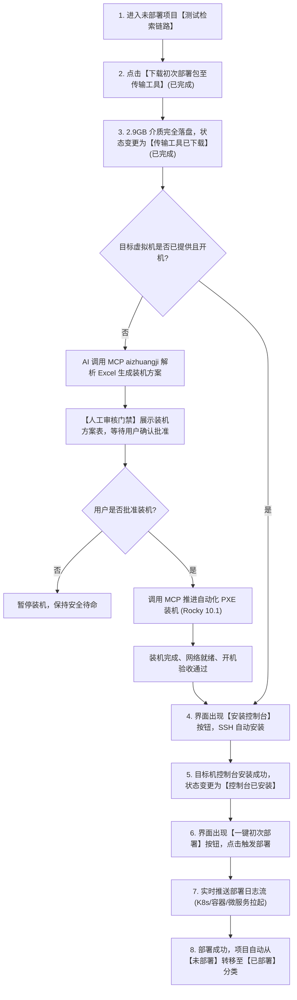

# 自动化运维传输工具（Implement Client）测试项与场景用例库

## 1. 测试功能矩阵

| 用例编号 | 功能模块 | 测试关注点 | 优先级 | 自动化支持 |
| :--- | :--- | :--- | :--- | :--- |
| **TC-TOOL-001** | 客户端拉起与初始化 | 相对路径启动、端口 `:8880` 监听、静态资源加载 | P0 | 是（全自动） |
| **TC-TOOL-002** | 跨环境缓存清空与重建 | 删除 `.sciyon` 目录后重启，验证新硬件 Key 生成 | P0 | 是（全自动） |
| **TC-TOOL-003** | 设备未授权锁定保护 | 无有效证书时自动拦截跳转至 `/lockpage` | P0 | 是（全自动） |
| **TC-TOOL-004** | 云端协同授权（toCloud） | 模拟点击前往云端授权，完成设备审批并签发 License | P0 | 是（全自动） |
| **TC-TOOL-005** | 云端打包项目实时同步 | 验证云端打包完成的项目（如 523）呈现在未部署列表 | P0 | 是（全自动） |
| **TC-TOOL-006** | 项目部署视图与日志查看 | 查看初次部署概览、刷新与下载部署日志 | P1 | 是（全自动） |

---

## 2. 真实端到端场景执行实录（实测通过）

### 实操环境与参数
- **客户端版本**：`V3.0.0.3`
- **目标云端**：测试环境 `10.88.12.80:18880`
- **操作用户**：超级管理员王壮（工号 `5807`）
- **关联项目**：`测试检索链路`（系统分配 ID: `523`，新版 Rocky10.1 底座）

### 真实交互流与断言结果
1. **进程直接拉起**：
   - 方式：通过无阻塞跨系统调用在 Windows Console 1 会话直接拉起 `自动化运维传输工具.exe`；
   - 断言：进程 PID 稳定常驻（占用内存 ~39.6MB），本地 `0.0.0.0:8880` 端口成功处于 LISTENING。
2. **硬件密钥生成断言**：
   - 检查 `C:\Users\wbz\.sciyon\mac\key`，新硬件散列标识 `9e1e1bce-6dca-4846-a222-95fe52ec1615` 顺利生成。
3. **锁定与授权断言**：
   - 浏览器打开 `http://localhost:8880/index/#/`，首屏呈现“前往云端授权机器”；
   - 真实点击该按钮触发 `toCloud()`，成功获取云端授权，生成 `user/44e41b79f94a483181c037808a92d15b.lic`。
4. **主界面与项目列表断言**：
   - 页面解锁，状态显示“科远云已连接”，当前用户为“王壮”；
   - 展开“未部署”下拉菜单，刚刚在云端完成打包的项目 **“测试检索链路”** 实时呈现在首位；
   - 点击该项目顺利进入“初次部署(测试检索链路)”主视图。

### 存证截图列表
- [未授权锁定拦截页截图](file:///mnt/d/wsl/workspace/autoDevV3.0/assets/transfer_tool_lockpage_unauthorized.png)
- [主界面已连接并识别用户截图](file:///mnt/d/wsl/workspace/autoDevV3.0/assets/transfer_tool_main_dashboard_logged_in.png)
- [测试检索链路项目初次部署主视图截图](file:///mnt/d/wsl/workspace/autoDevV3.0/assets/transfer_tool_project_523_deploy_view.png)
- [初次部署包下载进度截图（2.9GB）](file:///mnt/d/wsl/workspace/autoDevV3.0/assets/transfer_tool_downloading_init_package.png)
- [传输工具已下载与准备安装控制台截图](file:///mnt/d/wsl/workspace/autoDevV3.0/assets/transfer_tool_step2_install_console_ready.png)
- [安装控制台网络探测防护提示截图](file:///mnt/d/wsl/workspace/autoDevV3.0/assets/transfer_tool_install_console_network_prompt.png)
- [已部署项目模块管理全景截图](file:///mnt/d/wsl/workspace/autoDevV3.0/assets/transfer_tool_deployed_project_module_management.png)
- [已部署项目中间件管理全景截图](file:///mnt/d/wsl/workspace/autoDevV3.0/assets/transfer_tool_deployed_project_middleware_management.png)

---

## 3. TC-TOOL-007 初次部署全链路与状态流转规则

