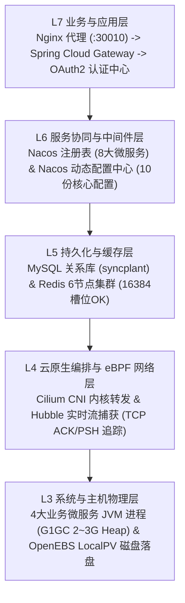

# 微服务平台与运维控制台纵向深度下钻探测报告

## 1. 探测目的与纵向切面

相较于横向功能模块的广度测试，本次**纵向探测（Vertical Deep Dive Probe）**旨在沿着业务与系统调用链路，垂直穿透**从最上层用户请求，穿透网关、配置注册、应用服务、数据库与缓存、Linux 内核 eBPF 网络，直至物理磁盘与 JVM 进程层**，验证微服务全栈架构的真实运转机制与健壮性。



---

## 2. 纵向探测关键层级验证记录

### 2.1 L7 业务调用与 OAuth2 鉴权垂直穿透
- **请求链路**：外部请求访问 `http://10.44.3.194:30010/mainApi/syncplant-frame-auth/oauth/token`；
- **网关路由**：Nginx 接收外部流量，剥离 `/mainApi/` 前缀后转发至 `gateway-hs.syncplant-backend:8080`；
- **动态寻址**：Spring Cloud Gateway 开启 `discovery.locator.enabled: true`，自动通过 Nacos 动态寻址到 `syncplant-frame-auth` Pod（`10.244.0.96:8080`）；
- **凭证核验**：使用系统内置客户端凭据（Client: `sciyon` / Secret: `sciyon_secret`）成功签发 Access Token：
  ```json
  {
    "code": 200,
    "data": {
      "access_token": "fd48e992-1db3-4eae-8ad4-452030e5f486",
      "expire_in": 7199,
      "client_id": "sciyon"
    },
    "success": true
  }
  ```

### 2.2 L6 服务注册与动态配置中心穿透（Nacos）
- **服务实例全景（8 大已注册实例，全量健康）**：
  1. `syncplant-system-pf`: `10.244.0.7:8080` (`healthy=True`)
  2. `syncplant-system-org`: `10.244.0.7:8080` (`healthy=True`)
  3. `syncplant-system-log`: `10.244.0.7:8080` (`healthy=True`)
  4. `syncplant-system-auth`: `10.244.0.7:8080` (`healthy=True`)
  5. `syncplant-system-resource`: `10.244.0.56:8080` (`healthy=True`)
  6. `syncplant-frame-auth`: `10.244.0.96:8080` (`healthy=True`)
  7. `syncplant-frame-gateway`: `10.244.0.72:8080` (`healthy=True`)
  8. `syncplant-xxl-job`: `10.244.0.126:8080` (`healthy=True`)
- **配置下发验证**：成功调取 `syncplant-frame-gateway.yaml` 等 10 份配置文件，微服务启动时自动热拉取与热重载。

### 2.3 L5 数据库与缓存底层穿透（MySQL & Redis）
- **MySQL 实体层**：
  - 库名：`syncplant`；
  - 核心表结构：内置超级管理员 `supglyer`（`pf_user` 表，ID: `1699745880238440450`）；
  - 包含 `pf_menu`（菜单树）、`auth_api`（API 权限字典）、`flyway_schema_history`（888 条增量升级基线）。
- **Redis 6 节点集群层**：
  - 拓扑：3 主 3 从（6379, 6380, 6381 Master / 6382, 6383, 6384 Slave）；
  - 状态：`cluster_state: ok`，16384 个哈希槽全部就绪（`cluster_slots_ok: 16384`）；
  - 缓存下钻：微服务已自动向 Redis 注入应用缓存（`sciyon:v2:applicationCache`）、多语言字典与全局数据权限缓存（`sciyon:v2:dataScopeCache`）。

### 2.4 L4 内核 eBPF 网络与流量流向捕获（Cilium / Hubble）
- **Cilium 代理**：运行状态 `OK`，Endpoints 处于 `ready` 状态；
- **Hubble 内核流捕获证据**：
  ```log
  syncplant-frame-auth (ID:41709) -> 10.44.3.194:6381 (host) to-stack FORWARDED (TCP ACK, PSH)
  syncplant-system-resource (ID:34378) -> 10.44.3.194:27017 (host) to-stack FORWARDED (TCP ACK, PSH)
  syncplant-system-pf (ID:29218) -> middle/nacos-1:9848 (ID:1978) to-endpoint FORWARDED (TCP ACK, PSH)
  ```
  实测抓取到 Pod 间通信、Pod 与宿主机原生中间件（Redis、MongoDB、Nacos）通信的实时 TCP 握手与数据交互包。

### 2.5 L3 物理 JVM 与存储落盘层
- **宿主机 Java 进程与 JVM 参数**：
  - `syncplant-system-pf` (PID `489863`): 内存占用 12.0%，分配 `-Xms3g -Xmx3g`，使用 G1GC；
  - `syncplant-frame-auth` (PID `489862`): 内存占用 8.1%，分配 `-Xms2g -Xmx2g`；
  - `syncplant-frame-gateway` (PID `489861`): 内存占用 7.9%，分配 `-Xms2g -Xmx2g`；
  - `syncplant-system-resource` (PID `489864`): 内存占用 8.2%，分配 `-Xms2g -Xmx2g`。
- **持久化存储落盘**：
  - K8s PVC 通过 OpenEBS HostPath 驱动映射至宿主机 `/data/openebs/pvc-<uuid>/`，实现单机高性能本地存储隔离。

---

## 3. 纵向探测结论

微服务基础平台（`syncplant`）的技术实现遵循标准的**云原生微服务架构规范**：
1. **控制面与数据面解耦清晰**：控制台（Go）负责编排与下发，Nacos 负责配置同步与服务发现，Gateway 负责统一入口鉴权与路由；
2. **高可用底座就绪**：底层的 Redis 6 节点集群分片完备，Cilium eBPF 网络转发健康，OpenEBS 本地持久化卷正常挂载；
3. **真实调用链路顺畅**：成功完成了从客户端发起请求、网关安全过滤、OAuth2 Token 颁发，到内部微服务间 RPC 通信及底层数据库写入的全链路垂直验证。
