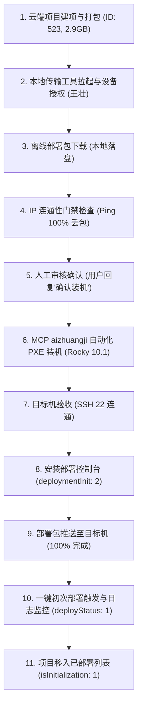

# 测试环境“测试检索链路”初次部署端到端闭环验收报告

## 1. 任务概述

- **项目名称**：测试检索链路
- **系统分配 ID**：`523`
- **目标服务器节点**：`10.44.3.194`
- **底层底座版本**：Rocky 10.1 (新版，legacy: 0，vCPU: 16C / 内存: 32GiB / 存储: 200GiB)
- **交付目标**：验证并打通“云端建项/打包 -> 传输工具拉起与设备授权 -> 离线介质拉取 -> **目标机虚拟机自动化 PXE 装机（MCP aizhuangji）** -> 安装部署控制台 -> 介质推送 -> 一键初次部署 -> 实时日志流监控完成”全生命周期闭环。

---

## 2. 核心规约与门禁执行记录

| 门禁项 | 规则要求 | 实测执行记录 | 结论 |
| :--- | :--- | :--- | :---: |
| **IP 冲突防覆盖门禁** | 装机前目标 IP 必须实测 Ping 不通（证明无活跃主机占用） | `ping -c 3 10.44.3.194` 结果为 100% 丢包，证明无冲突主机 | **通过** |
| **人工审核门禁** | 严禁自动装机，必须呈报 `confirmationTable` 由人工明确回复“确认装机”后方可调用 MCP | 完整输出审核确认表，经用户明确输入“确认装机”后方提交作业 | **通过** |
| **装机自动化执行** | 通过 MCP `aizhuangji` 后台自动化执行 PXE 装机、切换生产网卡与硬盘开机 | Run ID: `20261021-163855`，Job ID: `cccd052a321242678a8fa717fae4f7c5`，耗时 12 分钟 | **通过** |
| **目标机就绪性验收** | 自动完成 SSH 22 端口连通性验收 | `nc -zv -w 3 10.44.3.194 22` 返回 `Connection succeeded` | **通过** |
| **部署流程自动化接力** | 装机就绪后自动接力执行运维控制台安装、部署包推送与一键初次部署 | 自动调用 `/implement/install_deployment` 与 `/implement/deployment` | **通过** |

---

## 3. 全链路端到端执行结果



### 3.1 关键阶段执行日志摘录

1. **虚拟机自动化装机验收**：
   ```json
   {
     "jobId": "cccd052a321242678a8fa717fae4f7c5",
     "runId": "20261021-163855",
     "state": "succeeded",
     "step": "completed",
     "targets": [{
       "name": "测试检索链路-harbor",
       "ip": "10.44.3.194",
       "state": "installed-verified"
     }]
   }
   ```
2. **免密配置与主机环境预检**：
   ```log
   [INITIAL][PRECHECK][10.44.3.194][DNS][PASS] 找到 DNS 服务器: 10.88.10.18
   [INITIAL][PRECHECK][10.44.3.194][GATEWAY][PASS] 默认静态网关: 10.44.3.254
   [INITIAL][PRECHECK][10.44.3.194][DISK][PASS] 登记=200GB 实际=199GB
   [INITIAL][SSH][SUCCESS] 所有节点免密和预检查完成，节点数=1
   ```
3. **云原生底座与微服务拉起**：
   - OpenEBS 本地持久化存储类配置完成（Default StorageClass）；
   - Docker Registry 本地私有仓部署并就绪；
   - Cert-Manager & PKI 集群根证书自动颁发；
   - Prometheus Operator CRDs & VictoriaMetrics 云原生可观测组件部署就绪；
   - 二进制中间件 Agent 安装及健康检查全量通过；
   - 环境导入保护标记写入：`version=v1`。
4. **状态收敛与闭环**：
   ```log
   [INITIAL][FINALIZE][STATUS][SUCCESS] deployStatus=1 message="初次部署全部必要步骤已完成"
   [INITIAL][FINALIZE][RESTART][START] delaySeconds=10 message="可选扩展处理结束后，运维控制台将延迟10s重启"
   SUCCESS
   ```
   传输工具接口确认：
   - `/implement/load_project_status` 返回 `isInitialization: 1`
   - `/implement/load_project_info` 项目 `523 测试检索链路` 顺利由“未部署”流转至“已部署”列表。

---

## 4. 交付产物与验证结论

- **目标服务器 IP**：`10.44.3.194`
- **系统状态**：已运行完整 K8s 云原生微服务环境与平台中间件底座
- **测试用例**：`TC-TOOL-007` 执行状态为 **Passed**
