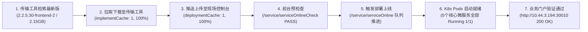

# 微服务基础平台最新版本拉取、上传与部署验收报告

## 1. 任务概述

- **项目名称**：测试检索链路（ID: `523`）
- **目标服务器**：`10.44.3.194`
- **目标模块**：微服务基础平台（模块 ID: `2`，模块编码: `syncplant`）
- **最新版本**：`2.2.5.30-frontend-2`（版本 ID: `2506`，介质大小: `2.15GB`）
- **交付目标**：通过传输工具拉取该最新版本 -> 上传至现场运维控制台 -> 控制台触发部署上线 -> 启动全套业务微服务 Pods 并验证正常运行。

---

## 2. 全链路执行记录

---

## 3. 部署微服务组件清单与运行状态

| 命名空间 | Deployment / Pod 名称 | 副本数 | 容器状态 | 端口/服务说明 |
| :--- | :--- | :---: | :---: | :--- |
| `syncplant-frontend` | `syncplant-web` | 1/1 | **Running** | 平台 Web 前台静态资源与业务门户 |
| `syncplant-backend` | `syncplant-frame-gateway` | 1/1 | **Running** | 统一 API 微服务网关 |
| `syncplant-backend` | `syncplant-frame-auth` | 1/1 | **Running** | 用户认证与鉴权中心 |
| `syncplant-backend` | `syncplant-system-pf` | 1/1 | **Running** | 平台系统核心基础微服务 |
| `syncplant-backend` | `syncplant-system-resource`| 1/1 | **Running** | 组织架构与系统资源微服务 |
| `syncplant-frontend` | `nginx-proxy` | 1/1 | **Running** | 业务反向代理主入口（`NodePort :30010`） |

---

## 4. 控制台前台状态确认

- **当前运行版本（runtimeVersion）**：`2.2.5.30-frontend-2`
- **运行状态（status）**：`1`（正常运行）
- **部署状态（deployStatus）**：`4`（发布完成）
- **部署进度（deployProgress）**：`100%`
- **Flyway 数据库脚本自动迁移（flywayStatus）**：`1`（成功）
- **对外门户访问验证**：`curl -I http://10.44.3.194:30010/` 返回 `HTTP/1.1 200 OK`
