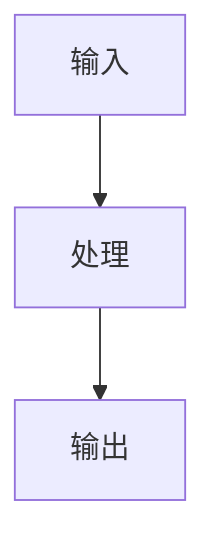

# 架构设计提示词

请在编码前完成系统设计，不要直接进入实现。

## 输入

- 需求文档
- 项目上下文
- 现有架构文档
- 技术栈约束

## 输出结构

# 架构设计

## 1. 设计目标

## 2. 系统边界

## 3. 模块划分

| 模块 | 职责 | 输入 | 输出 | 依赖 |
| --- | --- | --- | --- | --- |

## 4. 数据流与控制流

## 5. 接口设计

## 6. 数据模型

## 7. 技术选型

## 8. 测试策略

## 9. 风险与替代方案

## 10. ADR 建议

## 规则

- 先定义边界和接口，再讨论实现细节。
- 每个核心需求必须有设计覆盖。
- 复杂方案必须给出风险、替代方案和验证方式。
